<!-- LIVE URL: replace YOUR-APP.vercel.app below (the link definition + the bold label on the hero line) -->
[live]: https://YOUR-APP.vercel.app

# Docket

**Every renewal caught. Only the risky ones need you.**

[][live]

**[YOUR-APP.vercel.app][live]**

Deployed on Vercel · no login · start with the 3-minute guided tour

- **Take the tour:** the welcome screen offers it; reopen it any time with **Tour** in the top bar.
- **Switch employee** via **“Viewing as”** (top right), or open any page in the sidebar: the employee follows the page.
- **Evaluators:** see **Prototype Guide & Case Brief** and **Evals & Guardrails** in the sidebar.

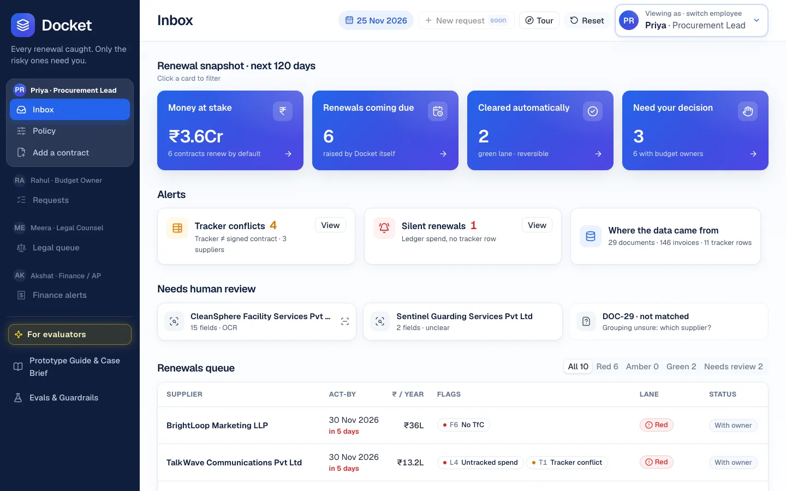

<a id="contents"></a>
## Contents

1. [Live prototype ↑](#docket)
2. [The problem & the idea](#2-problem-and-idea)
3. [Key highlights](#3-key-highlights)
4. [User journey](#4-user-journey)
5. [How it works](#5-how-it-works)
6. [Evals & guardrails](#6-evals-and-guardrails)
7. [Assumptions & scope](#7-assumptions-and-scope)
8. [Tech stack & repo structure](#8-tech-stack-and-repo)
9. [Run locally](#9-run-locally)
10. [Deploy on Vercel](#10-deploy-on-vercel)

<a id="2-problem-and-idea"></a>
<details open>
<summary><h2>2. The problem &amp; the idea</h2></summary>

**Velora Consumer** (fictional) has ~2,500 supplier contracts and no CLM. Contracts sit across SharePoint, shared mailboxes and DocuSign; renewals are tracked in a stale Excel sheet; payments run through the AP ledger (NetSuite).

**What goes wrong (from the case):** contracts auto-renew unreviewed, often with a price uplift; suppliers miss service levels and credits go unclaimed; invoices drift from agreed prices.

**Industry evidence**

| Finding | Source |
|---|---|
| 70% of tail-spend contracts renew without review | Vertice, Q3 2026 |
| 79% of IT leaders saw renewal price rises | Zylo 2026 |
| 8.6–11% of contract value leaks | WorldCC |

**The idea.** Nobody files a request for a renewal, so Docket **raises the intake request itself** before the act-by date. The existing backlog passes through one guarded front door; new-purchase requests use the same door later (v2).

**Why the renewal stage: stopping the problem at its source.** Docket intervenes at the renewal decision point, before a contract rolls into another term. Every contract is reviewed when it comes up for renewal: contracts that should not continue are exited, and those that do renew continue only on reviewed terms. Addressing the problem at this point stops it at its source. It prevents the issues the case highlights (unreviewed auto-renewals, missed service levels, and invoices that do not match agreed prices) from carrying into the next contract term, rather than having to detect and recover them after the fact.

- **Missed decisions compound:** every renewal locks in the next 12–24 months.
- **Cheapest point of leverage:** before signature, a fix is a decision; after it, it's a dispute or a wait.
- **Whole backlog, one cycle:** ~800 renewals a year put all 2,500 contracts through review.

**Velora sizing (assumption):** ~₹2,000 Cr indirect spend → ~₹800 Cr renews each year → ~₹320 Cr renews unreviewed → **₹25–40 Cr avoidable per year** (8–12% of the unreviewed value). In the demo data alone, the rules engine finds **₹43.14L** across the 10 suppliers.

</details>

<sub>[↑ Back to contents](#contents)</sub>

<a id="3-key-highlights"></a>
<details>
<summary><h2>3. Key highlights</h2></summary>

- **AI reads, Rules compute, Humans decide.** Claude reads and drafts; TypeScript rules do every date and ₹; people decide and send. Docket never negotiates.
- **16 checks on every renewal.** Contract terms, billing (AP ledger), SLA & usage, data quality; thresholds from Procurement's policy.
- **Every quote verified in code.** Each extracted value carries a verbatim citation; a quote not found in the document makes the value “unclear”.
- **OCR for scans, with human confirmation.** Image-only contracts are transcribed; OCR'd fields wait for a person before they can set a lane.
- **Evidence-based review routing.** The model's self-reported confidence didn't predict its errors, so fields go to a human on evidence (OCR, unverified quote, unclear, missing key field).
- **Persona handoffs with an audit trail.** Budget owner → Procurement → Legal, with Finance evidence; every step records its actor.
- **Live AI drafting with guardrails.** Notice wording around locked values; negotiation-language and number checks, retry once, then a labelled template.
- **Honest evals.** A blind held-out score, reported separately from the score after design fixes.

</details>

<sub>[↑ Back to contents](#contents)</sub>

<a id="4-user-journey"></a>
<details>
<summary><h2>4. User journey</h2></summary>

Captured automatically from the production build, from a fresh demo state.

**1. Welcome.** A first visit offers the 3-minute guided tour, which starts from a reset demo.
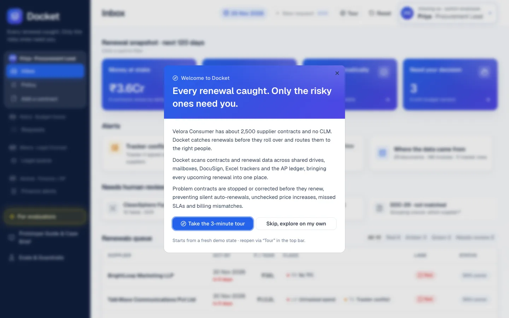

**2. Priya's dashboard.** Docket raised every renewal itself: money at stake, renewals due, auto-cleared, decisions needed.


**3. Alerts the tracker missed.** *Tracker conflicts → View* filters the queue to all three suppliers whose tracker row disagrees with the signed contract.
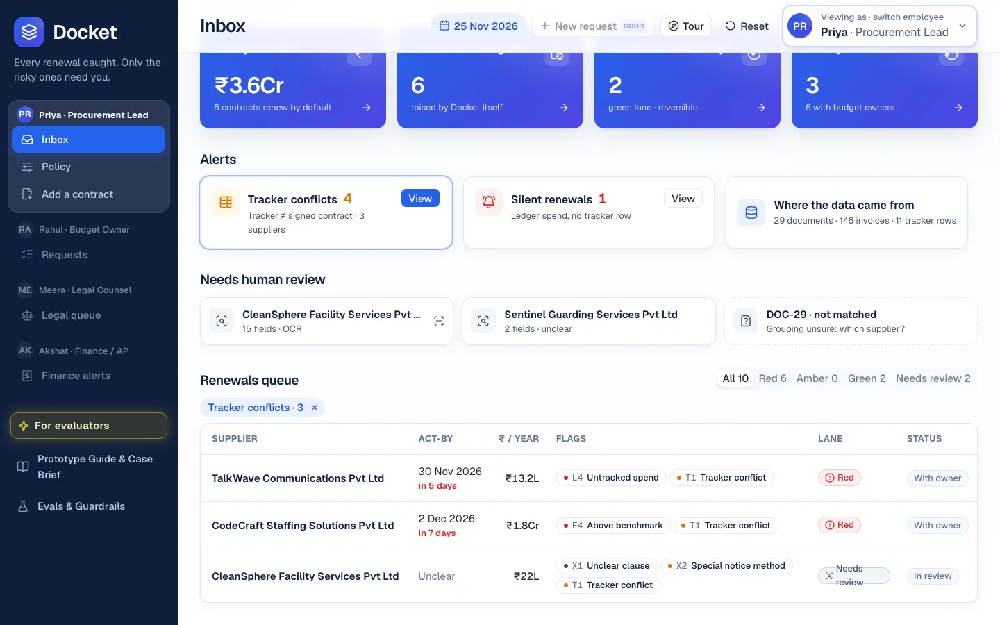

**4. TalkWave, the silent renewal.** ₹13.2L a year, auto-renews, act-by in 5 days, not in the tracker.
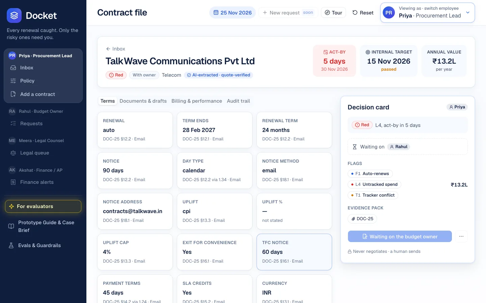

**5. Every value cites the contract.** The quote is checked in code; the injection hidden in Annexure 3 is ignored.
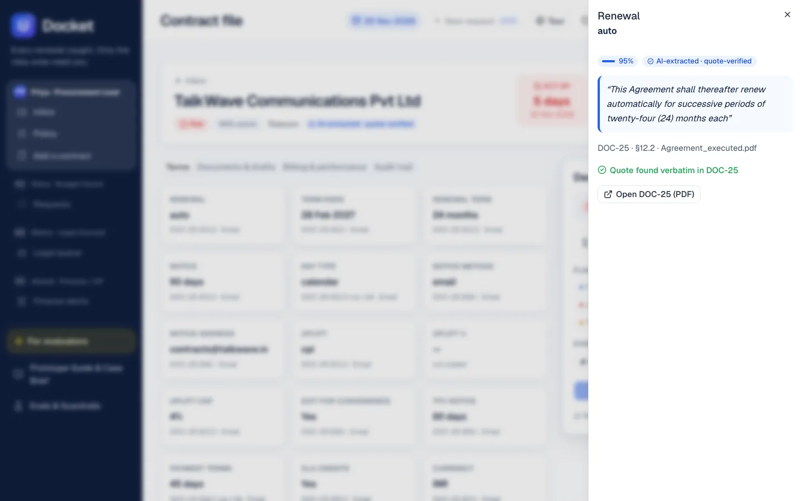

**6. Rahul decides (budget owner).** Plain language, two questions, three buttons; Nimbus shows 316 of 450 seats in use. He chooses **Exit** for TalkWave.
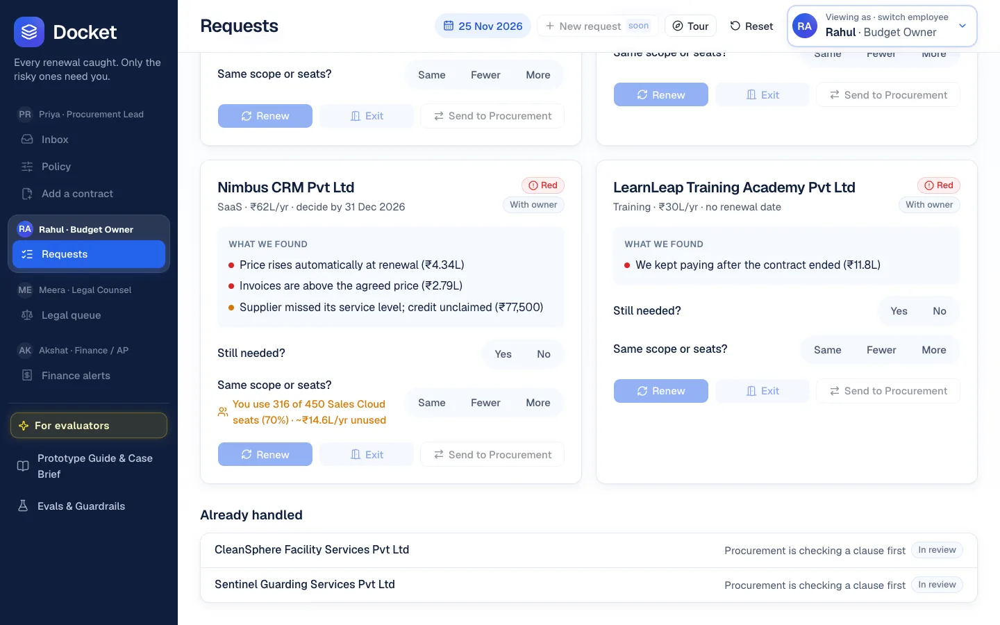

**7. Priya drafts the exit notice.** Rahul's decision is on the decision card; Claude writes the wording, Rules lock every date and ₹.
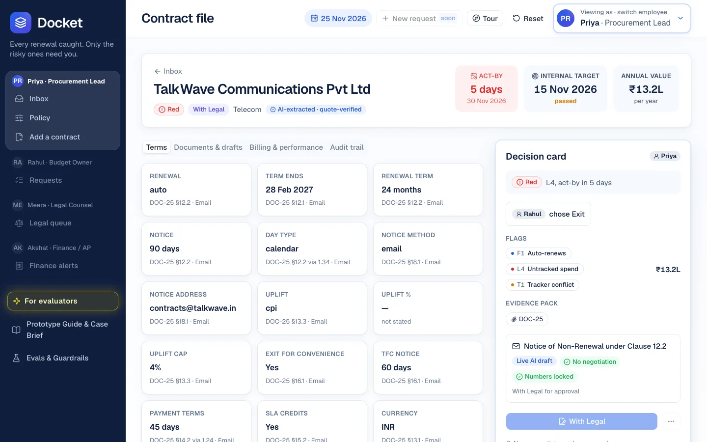

**8. Meera approves (Legal).** Locked fields as chips, guardrail badges, then *Approve & mark sent*; a human sends it outside Docket.
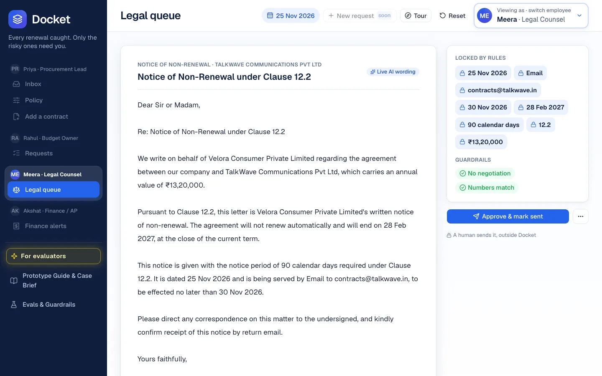

**9. Akshat confirms billing issues (Finance).** LearnLeap paid after expiry; Nimbus's ₹77,500 SLA credit unclaimed. Confirmed items join Priya's evidence pack.
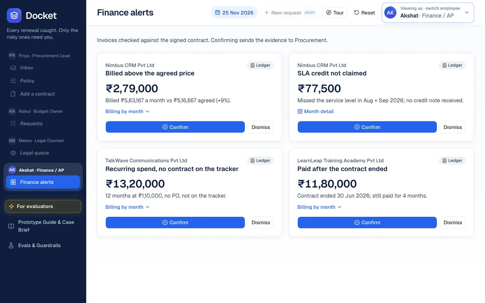

**10. Human review.** CleanSphere's scanned contract: Priya confirms the OCR'd fields and the rules re-run (needs review → amber).
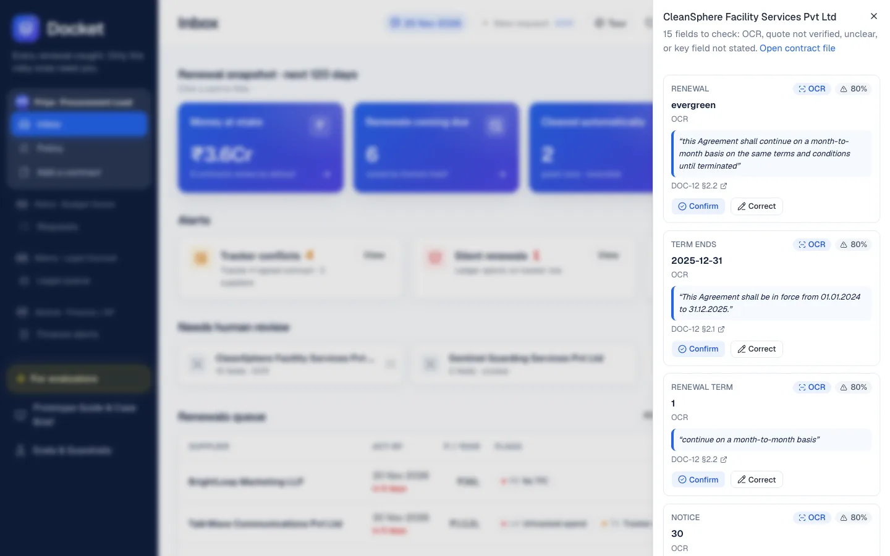

**11. Evals & Guardrails.** Blind vs after-fixes scores, then every eval and guardrail with counts and units.
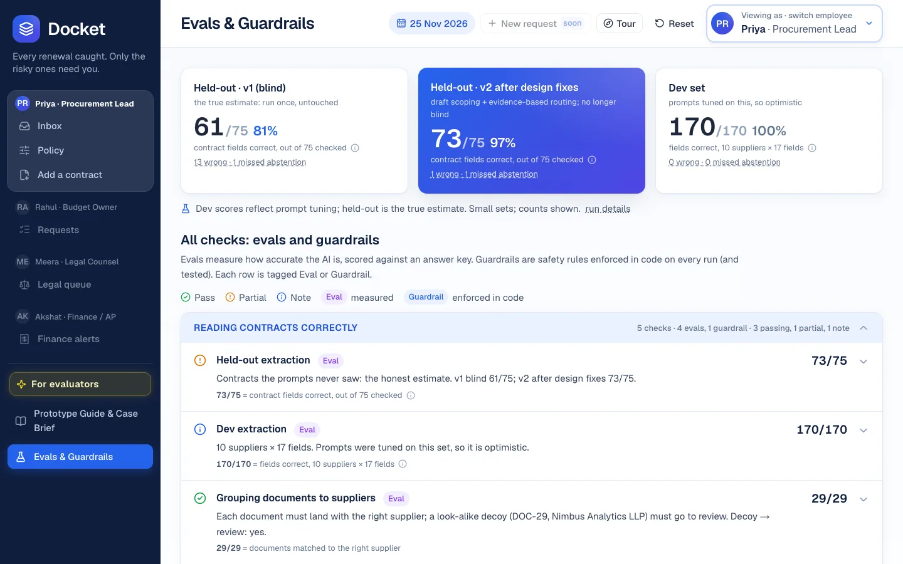

**12. Prototype Guide & Case Brief.** The case write-up, the value chain and the success metrics.
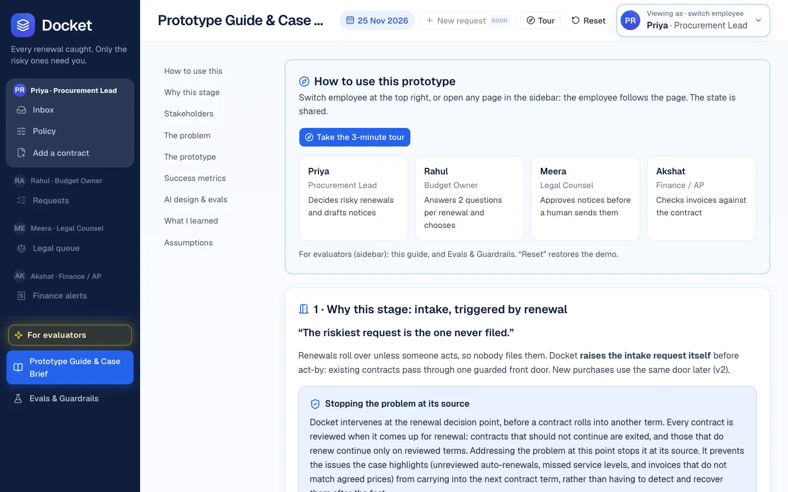

</details>

<sub>[↑ Back to contents](#contents)</sub>

<a id="5-how-it-works"></a>
<details>
<summary><h2>5. How it works</h2></summary>

```mermaid
flowchart LR
  S["Sources: SharePoint, shared mailboxes, DocuSign, tracker, AP ledger, SLA and usage reports"] --> T["PDF text layer, or OCR for scans"]
  T --> G["Grouping by legal IDs (CIN, GSTIN, envelope IDs), never filenames"]
  G --> E["Cited extraction: every value with a verbatim quote"]
  E --> V["Quote verification in code"]
  V --> R["Rules engine: act-by dates, every rupee figure, 16 checks"]
  R --> L["Lanes: green, amber, red, needs review"]
  L --> H["Persona handoffs: owner, Procurement, Legal, Finance"]
  H --> D["Drafting with guardrails: locked values, boundary and number checks"]
  D --> X["A human approves and sends"]
```

| AI (Claude, server-side) | Rules (TypeScript, deterministic) | Human |
|---|---|---|
| Reads PDFs (OCR for scans), groups documents by legal identifiers, extracts terms with verbatim citations, writes notice wording | Act-by dates (business days, holidays), every ₹ figure, FX, benchmarks, ledger / SLA / utilisation checks, lanes, routing | Confirms OCR / unclear fields, decides, approves and sends; nothing external is automated |

**Negotiation boundary:** Docket informs, routes and uses rights already in the contract (non-renewal notice, enforcing an existing price cap). Renegotiation is handed to Procurement, labelled “Out of scope”.

</details>

<sub>[↑ Back to contents](#contents)</sub>

<a id="6-evals-and-guardrails"></a>
<details>
<summary><h2>6. Evals &amp; guardrails</h2></summary>

Two sets: a **dev set** (the 10 demo suppliers, used to tune prompts) and a **held-out set** (18 unseen clauses and contracts, run once per prompt version). Figures from `docket_data/data/cache/eval_results.json`.

| Eval | Result |
|---|---|
| Held-out, **v1 blind** (the honest estimate) | **61/75** fields correct vs answer key |
| Held-out, **v2 after design fixes** (no longer blind) | **73/75** fields correct vs answer key |
| Dev set (prompts tuned on it) | 170/170 fields correct (10 suppliers × 17 fields) |
| Grouping | 29/29 documents matched to the right supplier; look-alike decoy sent to review |
| Citations | 218/218 quoted clauses found verbatim in the source (0 unverified) |
| Section accuracy | 145/152 citations point to the correct clause number |
| Abstention | 4/5 ambiguous items correctly answered “unclear” |
| Prompt injection | 7/7 checks where hidden instructions in a contract were ignored |
| Draft safety | 6/6 live drafts passed the negotiation and number checks (1 needed a retry) |
| Stability | 51/51 field values identical across 3 repeated runs (v1) |
| Rules tests | 230/230 automated tests of the rules engine against the answer key |
| Cost | ≈ $1.34 per full pipeline run (12 calls: OCR, grouping, 10 extractions) |

**Finding:** self-reported confidence didn't predict errors, so review routing is evidence-based; it sends 31 correct fields to review vs 48 for a confidence < 0.85 rule.

**Guardrails (enforced in code on every run)**
- No extracted field is used without a verified citation; “unclear” is a valid answer.
- The LLM never does arithmetic; every number and date in a draft must match the Rules values.
- Negotiation-boundary check on every draft (“discount”, “we propose”…): regenerate once, then the labelled template.
- Document text is untrusted: instructions inside contracts are ignored.
- All model output is zod-validated, retried once, then falls back to the labelled cache.
- Nothing external is sent automatically; every action is audit-logged. Live drafting is rate-limited per visitor.

</details>

<sub>[↑ Back to contents](#contents)</sub>

<a id="7-assumptions-and-scope"></a>
<details>
<summary><h2>7. Assumptions &amp; scope</h2></summary>

- Velora and all suppliers / documents are **synthetic**.
- Demo clock fixed at **25 Nov 2026**; USD→INR **84**; India CPI **5.2%** YoY.
- Internal decision target = **act-by − 15 days**; red lane at ≤ 14 days to act-by.
- Extraction is **pre-computed** by the AI pipeline; live AI runs only for drafting (rate-limited to ~10 drafts per visitor per hour, then the labelled template).
- **Out of scope:** negotiation (handed to Procurement); new-request intake (v2); production integrations (simulated with file exports: tracker, ledger, SLA and usage reports).

</details>

<sub>[↑ Back to contents](#contents)</sub>

<a id="8-tech-stack-and-repo"></a>
<details>
<summary><h2>8. Tech stack &amp; repo structure</h2></summary>

Next.js (App Router) · TypeScript · Tailwind · shadcn/ui · Zustand (persisted demo state) · zod · vitest · `@anthropic-ai/sdk` (Claude) · unpdf.

```text
src/app/            routes: inbox, requests, legal, finance, policy, contracts/[id], brief, evals; API: draft, docs, evaluate
src/components/     screens, app shell (persona-grouped sidebar), guided tour, Docket UI kit
src/lib/rules/      deterministic rules engine: act-by dates, ₹ maths, ledger / SLA / usage checks, lanes
src/lib/ai/         Claude pipeline: PDF text, OCR, grouping, cited extraction, precedence, guardrails, routing
scripts/            precompute (AI pipeline → cache), evals, sanity diff
docket_data/data/   case data: PDFs, tracker, ledger, SLA / usage reports, policy, cached AI output
docs/screenshots/   README screenshots (captured automatically)
```

</details>

<sub>[↑ Back to contents](#contents)</sub>

<a id="9-run-locally"></a>
<details>
<summary><h2>9. Run locally</h2></summary>

```bash
npm install
cat > .env.local <<'ENV'
ANTHROPIC_API_KEY=sk-ant-...
# optional, only for npm run precompute:
ANTHROPIC_MODEL_EXTRACT=claude-sonnet-5-5
ENV
npm run dev            # http://localhost:3000
```

Optional:

```bash
npm run precompute     # re-run the AI pipeline (OCR, grouping, extraction) into docket_data/data/cache
npm run evals          # re-run the evals (budget-guarded) → Evals tab
npm test               # rules engine, pipeline and app unit tests
```

The app works without a key: extraction comes from the committed cache, and drafting falls back to the labelled template.

</details>

<sub>[↑ Back to contents](#contents)</sub>

<a id="10-deploy-on-vercel"></a>
<details>
<summary><h2>10. Deploy on Vercel</h2></summary>

1. Import the repo into Vercel.
2. Set **`ANTHROPIC_API_KEY`** (required) in **Project → Settings → Environment Variables**.
3. Redeploy.

`ANTHROPIC_MODEL_EXTRACT` is optional and only used by a local `npm run precompute`. Keys are read only by server routes; nothing secret reaches the browser.

</details>

<sub>[↑ Back to contents](#contents)</sub>
